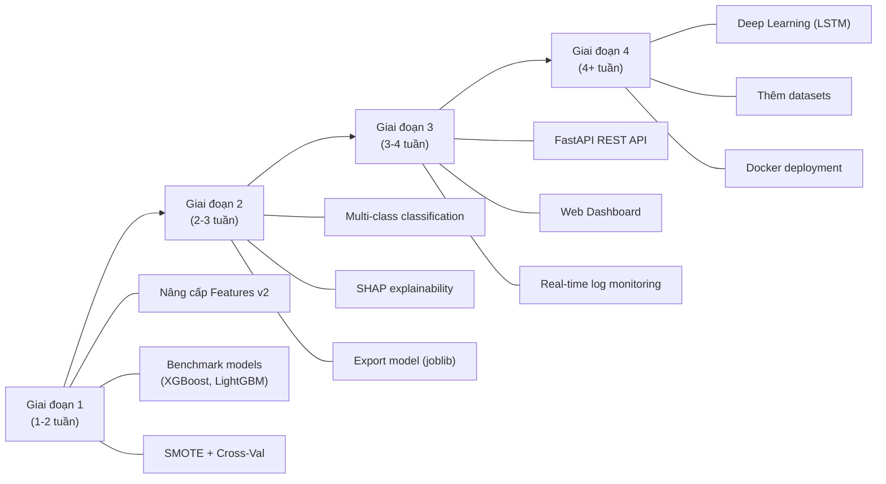

# 🛡️ Lộ Trình Phát Triển: Web Attack Detection using ML

## 📊 Phân Tích Hiện Trạng Dự Án

| Thành phần | Hiện tại | Đánh giá |
|---|---|---|
| **Dataset** | CSIC 2010 (~29MB) | ⚠️ Đơn lẻ, cũ |
| **Model** | Random Forest (n=300, depth=25) | ⚠️ Chỉ 1 model |
| **Features** | 14 features thủ công (regex-based) | ⚠️ Hạn chế |
| **Phân loại** | Binary (Normal/Attack) | ⚠️ Không phân biệt loại attack |
| **Accuracy** | ~92% (Recall Attack: 0.94) | ✅ Tốt |
| **Augmentation** | Copy 50 lần mẫu synthetic | ⚠️ Thô sơ |
| **Deployment** | Chỉ chạy trong Notebook | ❌ Chưa có |
| **Giao diện** | Không có | ❌ Chưa có |

---

## 🚀 6 Hướng Phát Triển (Xếp theo mức độ từ dễ → khó)

---

### 1. 🧠 Nâng Cấp Model & Pipeline ML

> **Độ khó**: ⭐⭐ | **Tác động**: Cao | **Thời gian**: 1-2 tuần

#### a) Thử nghiệm nhiều thuật toán
Hiện tại chỉ dùng Random Forest. Nên benchmark thêm:

```python
# So sánh nhiều model
from sklearn.ensemble import GradientBoostingClassifier
from sklearn.svm import SVC
from sklearn.neural_network import MLPClassifier
from xgboost import XGBClassifier          # ⭐ Rất mạnh
from lightgbm import LGBMClassifier        # ⭐ Nhanh + chính xác

models = {
    "Random Forest": RandomForestClassifier(n_estimators=300),
    "XGBoost": XGBClassifier(n_estimators=300, use_label_encoder=False),
    "LightGBM": LGBMClassifier(n_estimators=300),
    "MLP (Neural Net)": MLPClassifier(hidden_layer_sizes=(128, 64), max_iter=500),
    "SVM": SVC(kernel='rbf', probability=True),
}
```

#### b) Hyperparameter Tuning tự động
```python
from sklearn.model_selection import RandomizedSearchCV

param_dist = {
    'n_estimators': [100, 300, 500, 800],
    'max_depth': [10, 20, 30, None],
    'min_samples_split': [2, 5, 10],
    'min_samples_leaf': [1, 2, 4],
}

search = RandomizedSearchCV(
    RandomForestClassifier(), param_dist, 
    n_iter=50, cv=5, scoring='f1', random_state=42
)
```

#### c) Cross-Validation thay vì train/test đơn giản
```python
from sklearn.model_selection import StratifiedKFold, cross_val_score

cv = StratifiedKFold(n_splits=5, shuffle=True, random_state=42)
scores = cross_val_score(model, X, y, cv=cv, scoring='f1')
```

#### d) Xử lý mất cân bằng dữ liệu bằng SMOTE
```python
from imblearn.over_sampling import SMOTE

smote = SMOTE(random_state=42)
X_resampled, y_resampled = smote.fit_resample(X_train, y_train)
# Thay thế phương pháp copy 50 lần hiện tại
```

---

### 2. 🔬 Nâng Cấp Feature Engineering

> **Độ khó**: ⭐⭐ | **Tác động**: Rất cao | **Thời gian**: 1-2 tuần

Feature Engineering tốt ảnh hưởng tới accuracy **nhiều hơn** việc đổi model. Gợi ý bổ sung:

#### a) Thêm các feature mới
```python
import math
from collections import Counter

def extract_features_v2(url):
    url_decoded = unquote(str(url)).lower()
    
    features = extract_features(url)  # Giữ lại 14 features cũ
    
    # === FEATURES MỚI ===
    
    # 1. Entropy - Đo độ "ngẫu nhiên" của chuỗi (payload mã hóa có entropy cao)
    char_freq = Counter(url_decoded)
    length = len(url_decoded) or 1
    entropy = -sum((c/length) * math.log2(c/length) for c in char_freq.values())
    features['entropy'] = round(entropy, 4)
    
    # 2. Tỉ lệ ký tự đặc biệt / tổng độ dài
    features['special_ratio'] = round(features['special_char_count'] / length, 4)
    
    # 3. Chiều dài path vs query
    parts = url_decoded.split('?', 1)
    features['path_length'] = len(parts[0])
    features['query_length'] = len(parts[1]) if len(parts) > 1 else 0
    
    # 4. Số lượng dấu "/" (path depth)
    features['path_depth'] = url_decoded.count('/')
    
    # 5. Tỉ lệ chữ hoa (payload thường xen kẽ hoa/thường để bypass WAF)
    original = str(url)
    features['uppercase_ratio'] = sum(1 for c in original if c.isupper()) / max(len(original), 1)
    
    # 6. Chiều dài trung bình mỗi parameter
    params = url_decoded.split('&')
    features['avg_param_length'] = sum(len(p) for p in params) / max(len(params), 1)
    
    # 7. Double encoding detection
    features['double_encoded'] = 1 if '%25' in url_decoded else 0
    
    # 8. Null byte injection
    features['has_null_byte'] = 1 if '%00' in str(url) else 0
    
    return features
```

#### b) TF-IDF trên URL tokens
```python
from sklearn.feature_extraction.text import TfidfVectorizer

# Tokenize URL thành các từ/ký tự
tfidf = TfidfVectorizer(analyzer='char_wb', ngram_range=(3, 5), max_features=200)
tfidf_features = tfidf.fit_transform(urls)

# Kết hợp với features thủ công
import scipy.sparse as sp
X_combined = sp.hstack([X_manual, tfidf_features])
```

---

### 3. 🏷️ Multi-class Classification (Phân loại loại tấn công)

> **Độ khó**: ⭐⭐⭐ | **Tác động**: Rất cao | **Thời gian**: 2-3 tuần

Thay vì chỉ phân loại Normal/Attack, hãy **nhận diện loại tấn công cụ thể**:

```
0: Normal
1: SQL Injection
2: Cross-Site Scripting (XSS)
3: Path Traversal / LFI
4: OS Command Injection
5: Brute Force
6: Other Attack
```

#### Cách triển khai:
```python
def label_attack_type(url):
    url = unquote(str(url)).lower()
    
    if re.search(r'(select|union|insert|drop|--|xp_cmd)', url):
        return 1  # SQLi
    elif re.search(r'(script|alert|onerror|onload|javascript:)', url):
        return 2  # XSS  
    elif re.search(r'(\.\./|\.\.\\|/etc/passwd|boot\.ini)', url):
        return 3  # Path Traversal
    elif re.search(r'(bash|cmd|ping|wget|curl|/bin/sh)', url):
        return 4  # Command Injection
    elif 'login' in url and 'pass' in url:
        return 5  # Brute Force
    else:
        return 6  # Other Attack

# Tạo confusion matrix đa lớp
from sklearn.metrics import classification_report
target_names = ['Normal', 'SQLi', 'XSS', 'Path Traversal', 'CMDi', 'Brute Force', 'Other']
print(classification_report(y_test, y_pred, target_names=target_names))
```

---

### 4. 🌐 Xây Dựng Web Dashboard & REST API

> **Độ khó**: ⭐⭐⭐ | **Tác động**: Rất cao | **Thời gian**: 2-4 tuần

Biến notebook thành một **hệ thống hoàn chỉnh** với API + Dashboard:

#### a) REST API bằng FastAPI
```python
# api/main.py
from fastapi import FastAPI, UploadFile, File
import joblib

app = FastAPI(title="Web Attack Detection API")
model = joblib.load("models/rf_model.pkl")

@app.post("/predict")
async def predict(url: str):
    features = extract_features(url)
    prob = model.predict_proba([list(features.values())])[0][1]
    return {
        "url": url,
        "is_attack": prob > 0.35,
        "probability": round(prob, 4),
        "attack_type": classify_attack_type(url) if prob > 0.35 else "Normal"
    }

@app.post("/analyze-log")
async def analyze_log(file: UploadFile = File(...)):
    # Upload & phân tích cả file log
    ...
```

#### b) Real-time Dashboard
- **Hiển thị**: Số request Normal vs Attack theo thời gian thực
- **Bảng**: Top IP đáng ngờ, loại attack phổ biến nhất
- **Biểu đồ**: Attack distribution, hourly trends
- **Alert**: Cảnh báo khi phát hiện attack burst

```
Công nghệ gợi ý:
├── Backend:  FastAPI + WebSocket
├── Frontend: React/Next.js hoặc HTML + Chart.js
├── Database: SQLite/PostgreSQL (lưu lịch sử)
└── Charts:   Chart.js / Plotly / ECharts
```

---

### 5. 📦 Mở Rộng Dataset & Deep Learning

> **Độ khó**: ⭐⭐⭐⭐ | **Tác động**: Cao | **Thời gian**: 3-5 tuần

#### a) Sử dụng thêm dataset
| Dataset | Mô tả | Link |
|---|---|---|
| **CICIDS 2017** | Intrusion Detection đa dạng | [UNB](https://www.unb.ca/cic/datasets/ids-2017.html) |
| **HTTP DATASET CSIC 2010** | Đang dùng ✅ | - |
| **FWAF Dataset** | WAF bypass payloads | GitHub |
| **Payload All The Things** | Bộ sưu tập payload thực tế | GitHub |

#### b) Thử Deep Learning
```python
import tensorflow as tf
from tensorflow.keras.models import Sequential
from tensorflow.keras.layers import Dense, Dropout, BatchNormalization

# MLP Deep Network
model_dl = Sequential([
    Dense(256, activation='relu', input_shape=(n_features,)),
    BatchNormalization(),
    Dropout(0.3),
    Dense(128, activation='relu'),
    BatchNormalization(),
    Dropout(0.3),
    Dense(64, activation='relu'),
    Dropout(0.2),
    Dense(1, activation='sigmoid')
])

model_dl.compile(optimizer='adam', loss='binary_crossentropy', metrics=['accuracy'])
```

#### c) LSTM cho chuỗi ký tự URL (Character-level)
```python
from tensorflow.keras.layers import LSTM, Embedding

# Mô hình đọc URL như chuỗi ký tự → phát hiện pattern tấn công
model_lstm = Sequential([
    Embedding(input_dim=256, output_dim=32, input_length=max_len),
    LSTM(64, return_sequences=True),
    LSTM(32),
    Dense(1, activation='sigmoid')
])
```

---

### 6. 🔍 Explainability & Model Interpretation

> **Độ khó**: ⭐⭐ | **Tác động**: Trung bình-Cao | **Thời gian**: 1 tuần

Giải thích **tại sao** model đánh dấu một request là attack → rất quan trọng cho security analyst:

```python
import shap

# SHAP values - Giải thích từng dự đoán
explainer = shap.TreeExplainer(model)
shap_values = explainer.shap_values(X_test)

# Visualize feature importance
shap.summary_plot(shap_values[1], X_test, feature_names=feature_names)

# Giải thích 1 request cụ thể
shap.force_plot(explainer.expected_value[1], shap_values[1][0], X_test.iloc[0])
```

**Output mẫu**: *"Request này bị đánh dấu Attack vì: sql_keywords=5 (+0.32), special_char_count=12 (+0.18), path_traversal=3 (+0.25)"*

---

## 🗺️ Lộ Trình Đề Xuất



---

## ✅ Bạn Nên Bắt Đầu Từ Đâu?

> [!TIP]
> **Gợi ý ưu tiên cao nhất**: Bắt đầu với **Hướng 1 + 2** (Nâng cấp Model + Feature Engineering) vì đây là nền tảng, không cần thêm công nghệ mới, và sẽ cải thiện accuracy đáng kể nhất.

> [!IMPORTANT]
> Nếu mục tiêu là **làm đồ án/luận văn** ấn tượng, thì kết hợp **Hướng 3 (Multi-class) + Hướng 4 (Web Dashboard)** sẽ tạo ra sản phẩm demo rất thuyết phục.

Bạn muốn mình triển khai hướng nào trước? Mình có thể code trực tiếp vào project cho bạn! 🚀
